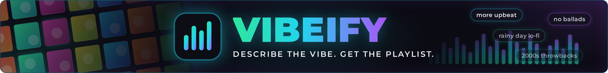
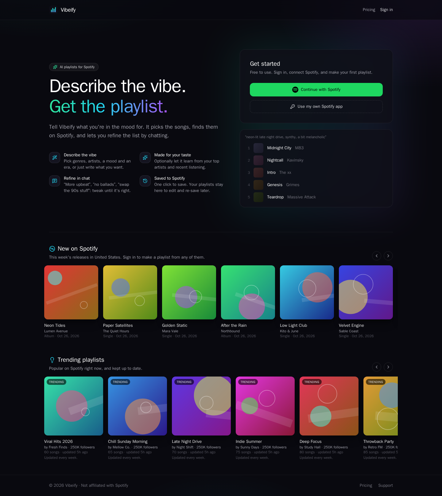
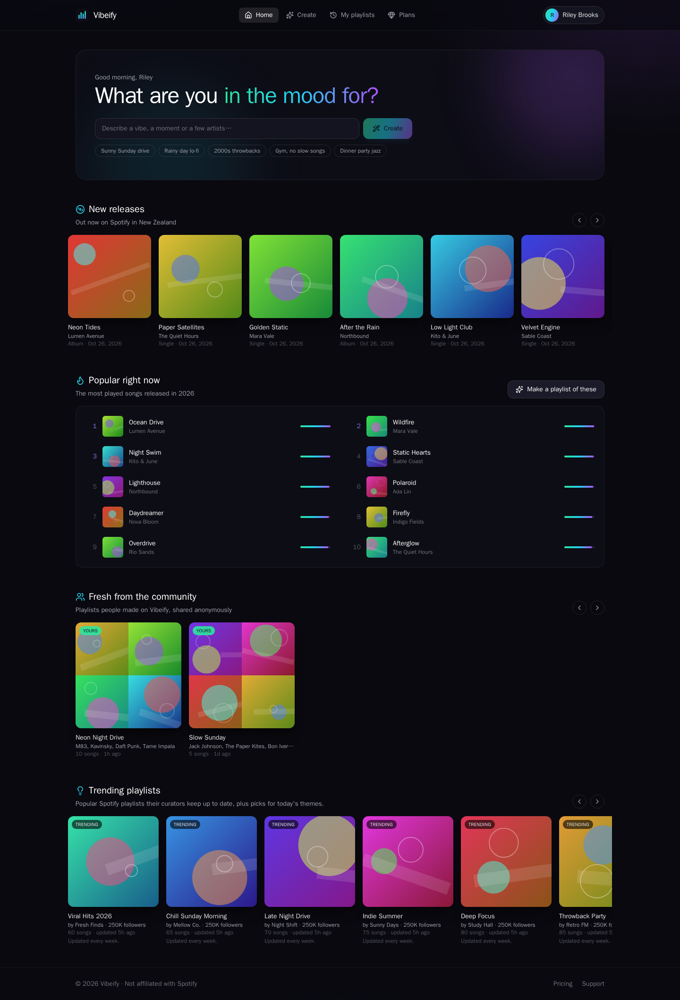
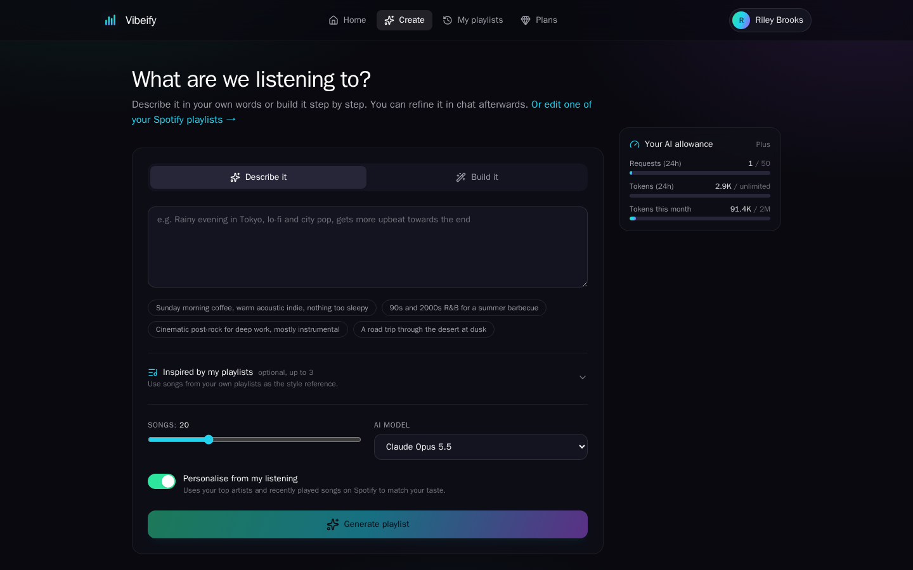
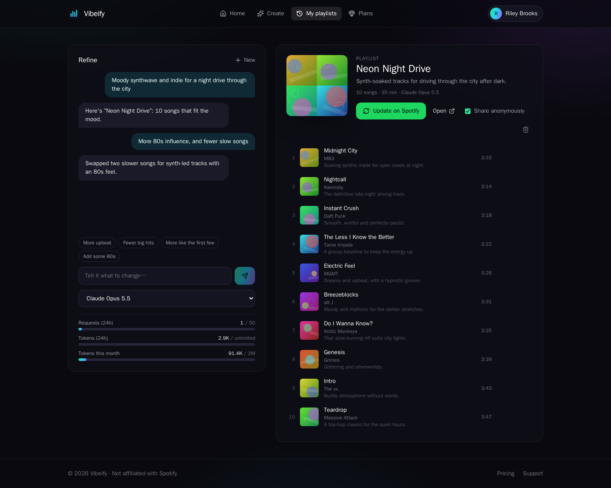
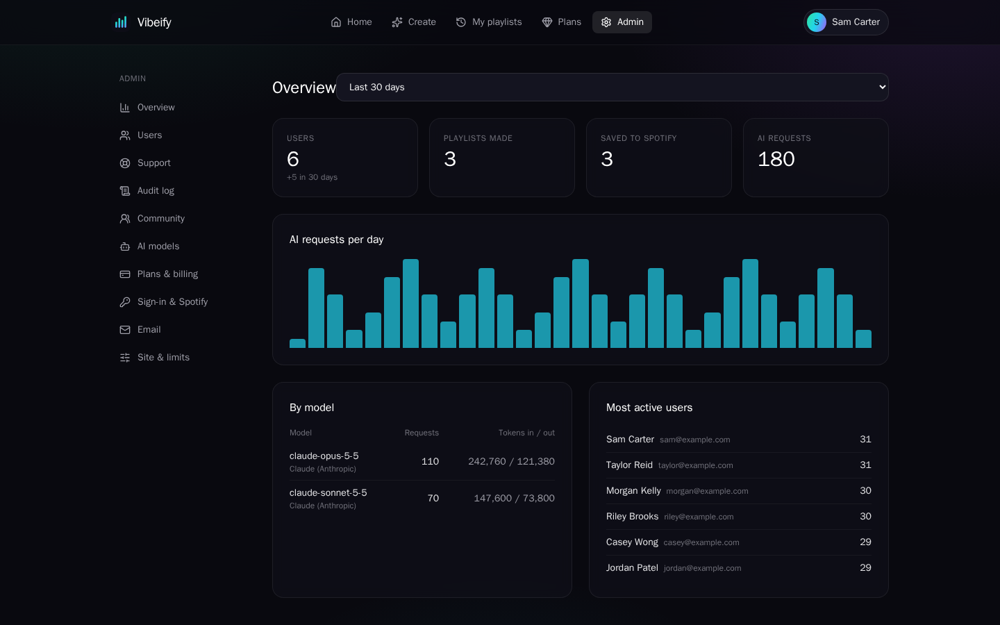
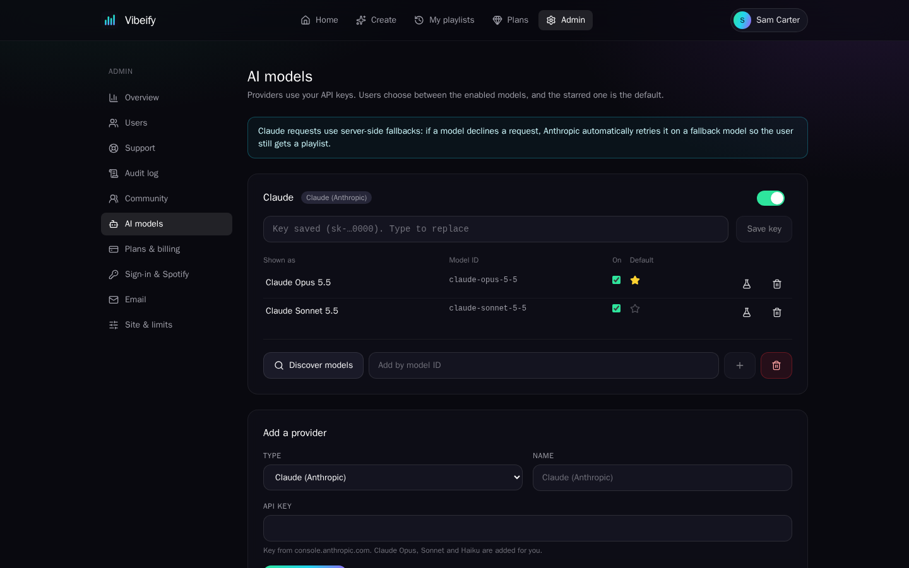

<p align="center">
  
</p>

# Vibeify

<p align="center">
  <b>Describe the vibe. Get the playlist.</b><br>
  Tell an AI what you want to hear, refine the list in a chat ("more upbeat", "no ballads"), and save it straight to
  Spotify.
</p>


---

## Features

**Making playlists**
- **Describe it or build it.** Write a prompt, or pick genres, artists, mood and era step by step.
- **Refine in a chat.** Ask for changes until it's right. Songs that can't be found on Spotify are shown but never
  saved.
- **Personalised.** Suggestions can use your top artists and recent listening.
- **Your own playlists.** Edit one of your Spotify playlists with AI, or use up to three as inspiration.
- **Save to Spotify.** Saved as private or public, and updated in place when you change it later.

**For signed-in people**
- **Home page.** New releases for your country, this year's popular songs, trending Spotify playlists, and a
  community feed of playlists others shared anonymously.
- **Sign in your way.** Spotify, Google, Apple, or email and password, all linked to one account.
- **Your data.** Download everything as JSON, see and sign out other devices, or delete your account.
- **Support.** FAQs, a contact form, and a page to follow your requests.

**For the site owner**
- **Any AI model.** Claude, OpenAI, Gemini, or any OpenAI-compatible server (Ollama, LM Studio, OpenRouter, vLLM). You
  choose the default model and whether people can pick another or bring their own key.
- **Memberships.** Free and paid plans, each with its own limits, features and AI models. Payment is through Stripe
  Checkout and the customer portal, with free trials, discounts and promotion codes.
- **Fair use.** Daily and monthly limits on requests and tokens, set per site, per plan or per person.
- **Admin panel.** Users, AI models, plans and payments, support inbox, community moderation, audit log, sign-in
  methods, email and site settings.
- **One container.** The backend serves the frontend. It runs on PostgreSQL, or SQLite for small installs.

## Screenshots

| Landing page | Home |
|--------------|------|
|  |  |

| Create | Playlist |
|--------|----------|
|  |  |

| Admin: overview | Admin: AI models |
|-----------------|------------------|
|  |  |

More in [`docs/screenshots`](./docs/screenshots), including pricing and mobile. The screenshots use demo data.

---

## Install

You need Docker, a [Spotify developer app](https://developer.spotify.com/dashboard), an API key for at least one AI
provider, and (for paid plans) a Stripe account.

```bash
git clone https://github.com/Jarsky/Vibeify.git
cd Vibeify
cp .env.example .env      # then edit it (see below)
docker compose up -d --build
```

Edit `.env` before starting:

| Variable | Value |
|---|---|
| `PUBLIC_URL` | The address people will use, e.g. `https://vibeify.example.com` (no trailing slash) |
| `SECRET_KEY` | A long random string: `openssl rand -base64 48`. Don't change it later: stored keys would become unreadable. |
| `POSTGRES_PASSWORD` | Any strong password for the bundled database |
| `BOOTSTRAP_ADMINS` | Your email (or Spotify user ID), so you're an admin when you first sign in |
| `SPOTIFY_CLIENT_ID`, `ANTHROPIC_API_KEY`, `OPENAI_API_KEY`, `GEMINI_API_KEY` | Optional. Used once on first start; after that, manage them in the admin panel |
| `VIBEIFY_PORT` | Host port (default `8000`) |

Put it behind a reverse proxy for HTTPS at `PUBLIC_URL`. Migrations run when the container starts.
Command-line admin: `docker compose exec vibeify python -m app.cli make-admin <email-or-spotify-id>`.

### Deploy to Render instead

`render.yaml` is a Render Blueprint: a Docker web service and a managed PostgreSQL database. In Render, choose
**New → Blueprint**, pick this repository, and enter `SECRET_KEY` and `BOOTSTRAP_ADMINS` when asked. Every push to `main`
deploys. To move an existing Compose install, run
`TARGET_DATABASE_URL='<Render external URL>' scripts/migrate-to-render.sh` and keep the same `SECRET_KEY`.

## Configure

Sign in at `PUBLIC_URL`, open **Admin**, and work through these:

1. **AI models.** Add a provider and its API key. Claude starts with its current models; for others use *Discover
   models*. Test one and star the default.
2. **Sign-in & Spotify.** Paste your Spotify app's Client ID, and add the redirect URI shown
   (`PUBLIC_URL/api/auth/spotify/callback`) to the app with *Web API* ticked. Add the Client secret too, so the landing
   page can show music. Turn on the sign-in methods you want.
   - **Google** (optional): an OAuth client of type *Web application*, redirect URI `PUBLIC_URL/api/auth/google/callback`.
   - **Apple** (optional): Services ID, Team ID, Key ID and the `.p8` key.
3. **Email** (optional). SMTP details, for email sign-up, password resets and support replies.
4. **Site & limits.** Site name, default limits, largest playlist size, whether people may bring their own AI keys or
   choose the model, and audit log retention.
5. **Plans & billing** (optional).
   - Create plans. Mark one free plan as the default.
   - Add your Stripe secret key (`sk_test_…` first). Saving a paid plan creates its Stripe product and price.
   - In Stripe, add a webhook to `PUBLIC_URL/api/billing/webhook` with these events: `checkout.session.completed`,
     `checkout.session.expired`, `customer.subscription.created`, `.updated` and `.deleted`, and for the payments log
     `invoice.paid`, `invoice.payment_failed`, `charge.refunded`, `charge.dispute.created` and `charge.dispute.closed`.
     Paste its signing secret into Vibeify.
   - Save the Stripe customer-portal settings once, then turn on **Sell paid plans**.

## Good to know

- **Spotify Development Mode.** A new Spotify app works for only 5 accounts you add under *User Management*, and its
  owner needs Premium. Turn on **Use my own Spotify app** so anyone else can connect through their own free developer
  app (a guided two-minute setup). Extended quota is only granted to registered businesses.
- **Limits apply in this order:** a person's own override, then their plan, then the default plan, then the site
  defaults. Requests on a person's own AI key don't count.
- **Billing is safe against missed webhooks.** Each Stripe event is applied once. A paid plan stops counting 3 days after
  its billing period ends, even if the cancellation webhook never arrives. Buying a plan needs Spotify connected first.
- **Behind Cloudflare,** the landing page uses the visitor's country (`CF-IPCountry`); otherwise it uses the US.
- **SSO in front of `/admin` works.** You can put `/admin` and `/api/admin` behind forward auth (Authentik, Authelia,
  Cloudflare Access) as an extra layer.
- **Security.** Argon2id passwords, hashed session tokens in HttpOnly cookies, a CSRF header on every change, stored
  keys and tokens encrypted at rest, rate-limited sign-in and support forms, and an audit log of every admin change.

## Development

- **Backend** (`backend/`): FastAPI, SQLAlchemy and Alembic. Run `pip install -e ".[dev]" && pytest`. Spotify, Stripe and
  the AI providers are faked in tests. After changing `app/models.py`, run `alembic revision --autogenerate -m "…"`.
- **Frontend** (`frontend/`): React, Vite and Tailwind. Run `npm ci && npm run dev` (it proxies `/api` to `:8000`).
- **Image:** one Docker image, in which the backend serves the built frontend.
- **CI:** every push and pull request runs lint and the backend tests, the frontend build and the Docker build.

## License

[MIT](./LICENSE). Not affiliated with Spotify. You're responsible for following Spotify's developer terms, your AI
providers' terms and your payment provider's rules.
